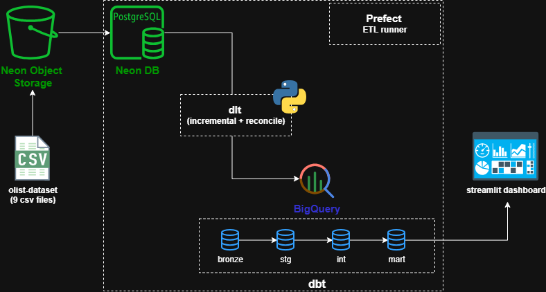

# Olist E-Commerce — Analytics Platform

A simulated Brazilian e-commerce OLTP database (Postgres on Neon, ~100k orders)
with an analytics pipeline feeding a BigQuery warehouse, dbt transformations,
Prefect orchestration, and a Streamlit dashboard.

## Architecture




## Prerequisites

- Python 3.12+
- [uv](https://docs.astral.sh/uv/)
- Docker + Docker Compose
- A Neon Postgres database (managed OLTP)
- A Neon Object Storage bucket holding the dataset CSVs
- A GCP project + BigQuery service-account key

## Dataset

The 9 Olist CSVs (~121 MB) are not shipped with the repo. Download the zip from
[Google Drive](https://drive.google.com/file/d/1HIy4LNNQESuXUj-u_mNJTCGCRrCeSbo-/view?usp=share_link)
and upload the CSVs to a Neon Object Storage bucket named `olist-dataset`, as
flat keys (no folder prefix). Full steps: [`packages/ecommerce_db/README.md`](packages/ecommerce_db/README.md).

## Configuration

```bash
cp .env.example .env
```

Fill in `.env` (read by every service from the repo root):

```dotenv
# OLTP database
POSTGRES_DB__DSN=postgresql://<user>:<password>@<host>/olist_db

# Neon Object Storage (required by `make seed`)
OBJECT_STORAGE__AWS_ENDPOINT_URL_S3=https://<region>.storage.<cloud>.aws.neon.tech
OBJECT_STORAGE__AWS_ACCESS_KEY_ID=<your-access-key-id>
OBJECT_STORAGE__AWS_SECRET_ACCESS_KEY=<your-secret-access-key>
OBJECT_STORAGE__AWS_REGION=<your-region>
# OBJECT_STORAGE__BUCKET=olist-dataset

# BigQuery warehouse
BIGQUERY__PROJECT=<gcp-project-id>
BIGQUERY__LOCATION=us-central1
BIGQUERY__KEYFILE=/absolute/path/to/service-account.json
```

Optional overrides (defaults in parentheses): `PIPELINE__NAME` (`ecommerce_pipeline`),
`PIPELINE__DATASET_NAME` (`bronze_data`), `PIPELINE__RECONCILE_NAME`
(`ecommerce_pipeline_reconcile`), `PIPELINE__RECONCILE_DATASET_NAME`
(`bronze_reconcile`), and the `DASHBOARD__*` gold-table names (see `.env.example`).

## Quickstart

```bash
# Seed Neon with the historical Olist data (one-shot, verified):
make seed

# Simulate live data (continuous, detached):
make simulate

# Full ELT: dlt ingest (Neon -> BigQuery bronze) -> dbt build (silver + gold + tests):
make elt

# Recover rows the incremental watermark skipped (periodic, optional):
make ingest-backfill SINCE=2026-10-01T00:00:00

# Launch the dashboard (reads BigQuery gold):
make dashboard
```

## Makefile targets

| Target | Description |
|---|---|
| `make help` | List all targets |
| `make docker-build` | Build the seeder/simulator image |
| `make seed` | Seed Neon from object storage (one-shot, row-count verified) |
| `make seed-local` | Seed locally via `uv` instead of Docker |
| `make simulate` | Run the continuous simulator (detached) |
| `make simulate-logs` | Follow the simulator logs |
| `make simulate-once` | One simulator batch locally (50 orders) |
| `make ingest` | dlt incremental run: Neon → BigQuery `bronze_data` |
| `make ingest-backfill` | dlt reconciliation run → `bronze_reconcile` (`SINCE=` required, optional `UNTIL=`) |
| `make elt` | Full ELT: dlt ingest → dbt build (the everyday command) |
| `make elt-build` | Build the baked ELT job image |
| `make elt-docker` | Run the full ELT inside a container |
| `make dbt-debug` | Verify the BigQuery connection + config |
| `make dbt-parse` | Re-render project; catch YAML/syntax errors |
| `make dbt-run` | Build all models (staging → intermediate → marts) |
| `make dbt-test` | Run all data tests (depends on `dbt-snapshot`) |
| `make dbt-build` | Full gate: models + snapshot + tests in order |
| `make dbt-snapshot` | Run SCD Type 2 snapshots only |
| `make dbt-docs` | Generate + serve lineage docs (localhost:8080) |
| `make prefect-server` | Start local Prefect server (localhost:4200) |
| `make prefect-flow` | Run ELT flow once (manual trigger) |
| `make prefect-serve` | Serve as daily 07:00 deployment |
| `make prefect-pool` | Create process work pool (one-time) |
| `make prefect-deploy` | Deploy flow to work pool |
| `make prefect-worker` | Start worker that pulls from pool |
| `make orc-*` | Containerized Prefect (server + worker: `up`/`down`/`logs`/`deploy`/`run`); see `docs/orchestration.md` |
| `make dashboard` | Launch the Streamlit dashboard (localhost:8501) |
| `make lint` | Run `ruff check` |
| `make format` | Run `ruff format` |

`make dbt-*` targets run from `packages/pipeline/dbt/` and pass
`--group dbt-bigquery` (installs the adapter) and `--env-file .env` (so
`BIGQUERY__*` reaches `profiles.yml`). `make elt` wraps both stages with
exit-code propagation; `make elt-docker` is the containerized version
(docs: `docs/elt-runner.md`).

## Project structure

```
olist-ecommerce/                # uv virtual workspace; members under packages/*
├── README.md
├── Makefile                    # short targets for common commands
├── pyproject.toml              # workspace root: members + sources + ruff config
├── .env / .env.example         # Neon DSN + object storage + BigQuery creds (gitignored)
├── packages/
│   ├── config/                 # shared settings (ConfigBase, PostgresDB, BigQuery, GoldTableRefs)
│   │   ├── README.md
│   │   └── src/config/         # paths.py, settings.py
│   ├── ecommerce_db/           # OLTP: schema, object-storage seed, simulator
│   │   ├── README.md
│   │   ├── Dockerfile          # Python 3.12 + uv (shared by seed + simulator)
│   │   ├── docker-compose.yaml # seed + simulator services (no local Postgres)
│   │   └── src/ecommerce_db/   # config.py, seed.py, simulator.py, helpers/
│   ├── pipeline/               # dlt ingest/reconcile + dbt + ELT runner
│   │   ├── README.md
│   │   ├── Dockerfile          # baked ELT job image
│   │   ├── docker-compose.yaml # one-shot elt job
│   │   ├── src/pipeline/       # config.py, ingestion.py, run_elt.py
│   │   └── dbt/                # models/, macros/, snapshots/, tests/
│   ├── orchestration/          # Prefect flows (host + container)
│   │   └── README.md
│   └── dashboard/              # Streamlit BI (reads BigQuery gold)
│       └── README.md
└── docs/
    ├── oltp-guide.md      # schema, seed, and simulator decisions
    ├── dlt-pipeline.md    # dlt pipeline architecture and decisions
    ├── dbt-guide.md       # dbt layers, schema strategy, tests, snapshots
    ├── elt-runner.md      # the `uv run elt` runner + Dockerized ELT job
    ├── orchestration.md   # Prefect setup, Airflow mapping, WSL2 notes
    └── dashboard.md       # Streamlit dashboard, config-driven tables
```

## Phase status

- [x] **0. Foundations** — repo layout, deps (uv), Makefile
- [x] **1. OLTP + seed** — Postgres schema, triggers, object-storage COPY loader
- [x] **2. Simulator** — fake backend generating live data + anomalies
- [x] **3. ELT (dlt)** — incremental Neon → BigQuery `bronze_data` + reconciliation
- [x] **4. dbt** — silver/gold star schema, SCD2 snapshots, 73 data tests
- [x] **5. Orchestration** — Prefect flows (Airflow port later)
- [x] **6. Serving** — Streamlit dashboard (daily digest pending)
- [ ] **7. Cloud (GCP)** — managed Postgres, managed orchestration, IaC

## Design decisions

See [`docs/`](docs/) for detailed decision logs on schema, ELT, dbt, and orchestration choices.
